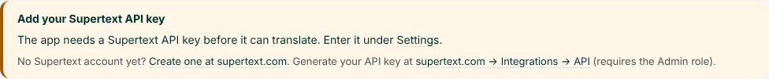

# Installation guide — Supertext Translation for Wix

For site owners and administrators setting up Supertext Translation on a Wix site.

> **Status: in development.** The app is tested against a stand-in of the Wix APIs. It isn't in the Wix App Market yet, and it hasn't been tried on a real Wix Stores site. Ask Supertext before using it on a live site.

## How it works

Supertext Translation is a Wix app. It adds a **Translate with Supertext** page to your site's dashboard. The app runs on Supertext's servers: it reads the texts to translate from **Wix Multilingual**, has Supertext AI translate them, and saves the translations back to Wix Multilingual. You review and publish them there, as with translations you make by hand.

Nothing is installed on your site except the app itself, and the app only changes translations, never your original content.

## Requirements

| | |
| --- | --- |
| Wix site | Any Wix or Wix Studio site with the content you want to translate, for example a Wix Stores shop or a Wix Blog |
| Wix Multilingual | Added to the site, with at least one language besides the main language (step 2) |
| Supertext | An account with an API key, see [Get a Supertext account and API key](#1-get-a-supertext-account-and-api-key) |
| Permissions | Adding apps to the site (site owner or an admin collaborator) |

## 1. Get a Supertext account and API key

1. **Account:** no Supertext account yet? [Log in or create one](https://www.supertext.com/person/en/account/signin) with your email address.
2. **API key:** generate it at [supertext.com → Integrations → API](https://www.supertext.com/en/integrations/api). Only users with the **Admin** role in the Supertext account can do this; otherwise ask your Supertext account admin for a key.

The app's settings page links to both, next to the API key field.

## 2. Set up your languages in Wix Multilingual

The app translates into the languages your site has in Wix Multilingual, from the site's main language.

1. In your site's dashboard, open **Wix Multilingual** (search the dashboard for "Multilingual" if you don't see it; add it if it isn't on the site yet).
2. Add each language you want, with its region where it matters (for example *German (Switzerland)*). A language can stay hidden from visitors while you translate; the app translates hidden languages too.
3. In the app's **Settings → Languages**, check that every language has a Supertext language (see [Languages](#languages) below).

Wix Multilingual decides which content can be translated: what it lists in its Translation Manager (Wix Stores products and categories, Wix Blog posts and other apps' content) is what the app offers.

## 3. Install the app

The app isn't in the Wix App Market yet. Supertext sends you an install link for your site; open it while logged in to Wix, choose the site and confirm the permissions:

| Permission (as Wix shows it) | Why |
| --- | --- |
| Wix Multilingual – read translation content | Read the original texts and existing translations |
| Wix Multilingual – write translation content | Save the translations |
| Wix Multilingual – manage translations | Read the site's languages |

After installing, the app appears in your dashboard's sidebar under **Apps** as **Supertext Translation**.

## 4. Enter the API key

Open **Supertext Translation → Settings** in the dashboard:

1. Paste your key into **API key** and click **Save**. You can paste it exactly as Supertext shows it, with the leading `Supertext-Auth-Key`, or without it. The key is stored encrypted.
2. Saving checks the key with Supertext right away (without translating anything) and shows the result: *API key checked: the connection to Supertext works.* means everything is in place. **Test connection** runs the same check again, also for a key you typed but haven't saved yet.

No Supertext account yet? Create one at [supertext.com](https://www.supertext.com/person/en/account/signin). Generate your API key at [supertext.com → Integrations → API](https://www.supertext.com/en/integrations/api) (requires the Admin role).

Until a key is saved, the translate page asks for one:

## All settings

All settings are per site, in **Supertext Translation → Settings**.

| Setting | Default | Purpose |
| --- | --- | --- |
| API key | – | Your Supertext key, with or without the `Supertext-Auth-Key` prefix; stored encrypted. *Remove the saved key* deletes it. |
| Test connection | – | Checks the key (entered or saved) with Supertext, without translating anything. Saving the settings runs the same check; the page shows the last result and when it ran. |
| Form of address | Let Supertext decide | *Formal* (German "Sie", French "vous") or *Informal* ("du", "tu"). Sent only for languages where Supertext offers it; for English, Swiss German, Romansh, Albanian and Serbian Supertext decides (the page names them). |
| Mark translations as ready to publish | On | On: translations go live on the site's language versions right away. Off: they wait in the Translation Manager until you mark them ready to publish. |
| Languages | the site language's own code if Supertext offers it, else its default (`de` → `de-DE`) | The Supertext language each site language is translated into (and, for the main language, translated from). See [Languages](#languages). |
| Translation review (per language, under Languages) | Off | Translations into that language go through Supertext's review service, where reviewers correct them on the website. See [Translation review](#translation-review). |
| Send version information to Supertext | On | See [Version information](#version-information). |

The settings page also shows the app's version, linked to its release notes.

### Languages

Supertext offers each language in one exact form: `de-CH`, `de-DE`, `de-AT`, `fr-CH`, `fr-FR`, `it-CH`, `it-IT`, `en-US`, `en-GB`, `pt-BR`, `pt-PT` (with region), `zh-Hans`, `zh-Hant`, `sr-Latn`, `sr-Cyrl`, Swiss German (Zurich, Bern), and without region for all others (`es`, `nl`, `ja` …).

Under **Settings → Languages** every site language has a combo box with Supertext's languages, shown as *Name (code)* in your dashboard language. Each one is preselected with the saved choice, else the obvious one:

- A site language whose code Supertext offers as it is (for example *German (Switzerland)*, `de-CH`, or *Spanish*, `es`) is preselected with that code.
- Otherwise the usual default, if there is one:

  | Site language | Preselected Supertext language |
  | --- | --- |
  | `de` | `de-DE` |
  | `en` | `en-US` |
  | `fr` | `fr-FR` |
  | `it` | `it-IT` |
  | `pt` | `pt-PT` |
  | `zh`, `zh-CN`, `zh-SG` | `zh-Hans` |
  | `zh-TW`, `zh-HK`, `zh-MO` | `zh-Hant` |
  | `sr`, `sr-Latn-RS` | `sr-Latn` |
  | a region of a language Supertext offers without region (`es-ES`, `es-419`, `nl-NL`, `nb-NO`) | that language (`es`, `nl`, `nb`) |

  A language nobody has chosen for is translated into this default too, so Wix sites with bare languages (*German*, `de`) work right away. Choose another variant where you need it, for example *German (Switzerland)*.
- Languages without an obvious choice (for example `en-IE`, `de-LI`, `fr-BE`, `sr-RS` or Swiss German `gsw`) show *— Not translated: choose a Supertext language —* and are marked *No Supertext language*. They aren't translated until you choose one, and editors who choose them get a message that sends them here.
- For the main language you choose the language Supertext translates from (`en`, `de` …); its own code is preselected if Supertext has it (`en-US` → `en`).
- **Translation review** (a checkbox next to each language the site is translated into, off by default): see [Translation review](#translation-review).

**Save** stores the selected code for every language (existing choices stay as they were). Only codes from the list can be saved. The mapping is per site; there is no server-wide override.

### Version information

**Send version information to Supertext** (on by default) sends a short report to Supertext's Commando Center when you save the settings and when the app or its runtime was updated, so Supertext support can see which version your site runs:

- the site's URL (its published address; for an unpublished site its Wix dashboard address `https://manage.wix.com/dashboard/<site ID>`),
- the app (`Wix-Supertext-Translation`) and its version, `Wix` as the system, the Node.js version the app runs on, and the version of the Supertext SDK,
- whether an API key is set and the result of the last key check (*ok*, *invalid*, *missing*, *unreachable* or *error*, with its time and Supertext's HTTP status).

No content, no API key and no personal data are sent. As a hosted app it has no callback address (no ping). Turn the checkbox off and save to stop the reports for your site; the key check on saving still runs. Supertext can also turn reports off for all sites on the app's server (`SUPERTEXT_VERSION_REPORTS=0`); the setting then says so.

## Translation review

With **Translation review**, people check the translations on the website itself and correct them there: you, your colleagues or Supertext linguists open the original and the translated page side by side in Chrome with the *Supertext Localization Review* extension and fix texts in a side panel. Their corrections come back into Wix.

Turn it on per language the site is translated **into**: **Supertext Translation → Settings → Languages**, tick **Translation review** next to the language (e.g. *German (Switzerland)*) and click **Save**. Untick it to turn it off again; nothing else changes.

- Translations into that language then go through Supertext's review service instead of directly to Supertext. It answers exactly like Supertext and passes everything on with your API key, so billing, languages, form of address and error messages stay the same. Other languages keep going directly to Supertext.
- The review service keeps every translation of your account. A text it has translated before gets the same translation again (without a new Supertext call), and once a reviewer has corrected it, the corrected text.
- **Corrections arrive with the next translation:** after a review, translate the items into that language again (*Translate with Supertext*, with **Overwrite existing translations** ticked, since the fields are translated already) to write the corrections into Wix Multilingual. As always, overwriting replaces changes made by hand in the Translation Manager.
- Reviewers get a review link for your site from Supertext; nothing to set up in Wix.
- The review service works with keys of the live Supertext API (the keys you generate on supertext.com).
- *Export for translation* and *Import translation* don't use the review service. The API key check (*Test connection*, saving the settings) still goes directly to Supertext.
- Supertext can turn Translation review off for all sites on the app's server; the checkboxes are then greyed out and the page says so.

## Who can translate

Everyone who can open the app's pages in the site's dashboard: the site owner and collaborators whose role gives access to apps. The app checks on every request that it comes from the Wix dashboard of that site (Wix's signed app instance).

**Translation files** (*Export for translation* and *Import translation* on the translate page) need nothing to set up and no API key; the same people can use them. Uploads are limited to 10 MB, read in memory and never stored; imported translations follow *Mark translations as ready to publish*. See the [user guide](USER_GUIDE.md#translation-files-export-for-translation-import-translation).

## Updating

Nothing to do: the app runs on Supertext's servers and is updated there. The settings page shows the current version.

## Uninstalling

In your site's dashboard, open **Apps → Manage Apps**, find **Supertext Translation** and remove it. Translations made so far stay in Wix Multilingual. The app deletes your settings (including the stored API key) when Wix tells it the app was removed.

## Troubleshooting

| Message | Cause / fix |
| --- | --- |
| *This file isn't a valid XLIFF or HTML translation file* / *This file wasn't exported by the Supertext app …* | The imported file is damaged, another kind of file, or the translator removed its metadata (HTML head, XLIFF file header). Export again and ask the translator to keep the structure. |
| *The file is too large (at most 10 MB)* | Export fewer languages per file. |
| *This page has expired. Reload it from the Wix dashboard.* | The app's page was opened outside the dashboard or the link is too old. Open it again from the sidebar. |
| *Add your Supertext API key* / *No Supertext API key configured* | Enter the key under Settings (step 4). |
| *Authentication failed* / *Supertext rejected the API key* | The key is wrong or revoked. Check that you copied the whole key, or generate a new one at [supertext.com → Integrations → API](https://www.supertext.com/en/integrations/api) (Admin role required). No Supertext account yet? Create one at [supertext.com](https://www.supertext.com/person/en/account/signin). |
| *No API key is set yet* | Enter the key and save (step 4). |
| *The API key couldn't be checked because Supertext can't be reached* | The settings are saved; Supertext or the network was down. Click **Test connection** later. |
| *The API key couldn't be checked: Supertext answered with an error (…)* | The settings are saved; Supertext answered unexpectedly (HTTP status in brackets). Try **Test connection** later; if it stays, contact Supertext support. |
| *"…" has no Supertext language yet, so nothing was sent* / *No Supertext language* | That site language has no exact Supertext code (for example *German*, `de`, or `zh-CN`). Choose its Supertext language under Settings → [Languages](#languages). |
| *Saved, except these language codes, which Supertext doesn't offer* | Only the languages in the select can be saved; choose one of them. |
| *Supertext doesn't offer formal or informal address for …* | Choose *Let Supertext decide* under Settings → Translation (normally the app doesn't send the form of address for such languages). |
| *Add a second language* | Wix Multilingual has only the main language. Add languages (step 2). |
| *Wix Multilingual isn't set up on this site* | Add Wix Multilingual and a second language (step 2). |
| *Wix Multilingual has no translatable content on this site yet* | Nothing on the site uses Wix Multilingual's translation yet (for example no products). Add content in the main language. |
| *Wix refused the request* | The app lacks a permission, for example after Wix added a new one. Reinstall the app to grant it. |
| *Supertext doesn't translate from … into …* | Supertext doesn't offer that pair. Choose another Supertext language for it under Settings → [Languages](#languages). |
| *… too long for Wix, not saved* | The translation is longer than Wix allows for that field (e.g. a product name). Shorten it by hand in the Translation Manager. |
| *Too many requests to Supertext* | Supertext's per-second limit was still exceeded after 4 automatic retries. Wait a moment and translate again. |
| *Your Supertext translation limit is exceeded* | Your Supertext plan's volume is used up. |
| *Authentication failed* only for languages with *Translation review* | The review service only works with keys of the live Supertext API. Untick *Translation review* for that language, or ask Supertext support. |
| Reviewers' corrections don't show up in Wix | They arrive with the next translation: translate the items into that language again with **Overwrite existing translations** ticked. Check that the language's *Translation review* is ticked under Settings → Languages. |
| *Translation review is turned off on this server* | Supertext turned the review service off for the app (`SUPERTEXT_REVIEW_URL` is empty); the saved choices are kept. Ask Supertext support. |
| *The app restarted during the translation* | Start the translation again; items already done are kept (they show *Already translated, unchanged*). |

## Privacy and security

- The texts you translate are sent to Supertext (api.supertext.com) and deleted there right after download (they expire after 24 hours anyway).
- For languages with [Translation review](#translation-review) on, they go through Supertext's review service, which keeps the texts and their translations (per API key) so reviewers can correct them and later translations reuse them.
- The app stores per site: the Supertext API key (encrypted), the settings above, the last API key check and version report (no key, only a fingerprint to notice a changed key), and the list of recent translations (item names and results). It doesn't store your content.
- Version information: see [Version information](#version-information).
- The app never changes your site's original texts; it only writes translations.
