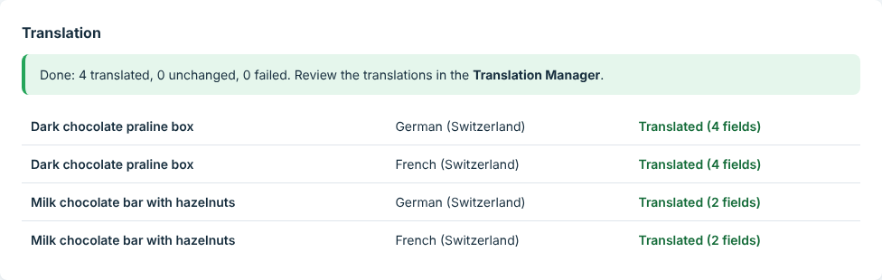
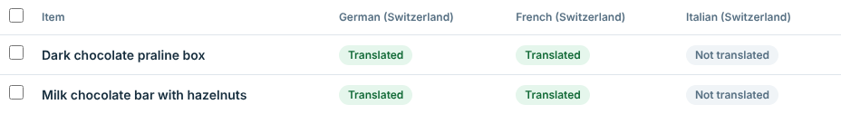
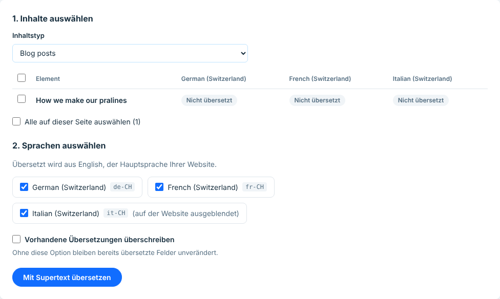
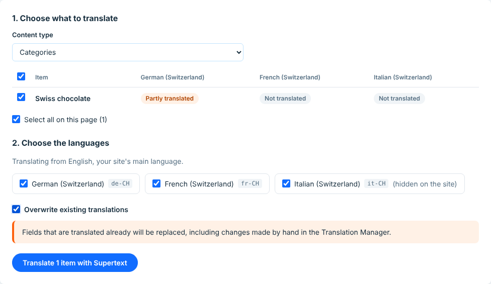
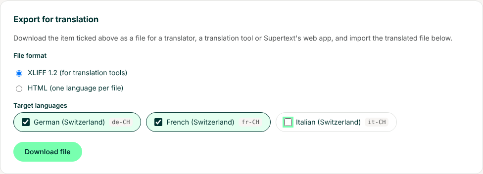
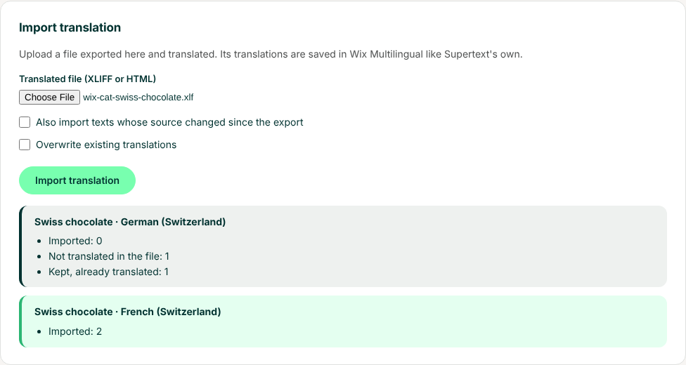

# User guide — Supertext Translation for Wix

For editors. Once the app is set up (see [INSTALLATION.md](INSTALLATION.md)), you translate your site's products, categories, blog posts and other content from the Wix dashboard. The translations are saved in Wix Multilingual, where you review them like translations made by hand.

*Screenshots: the app's pages with sample content (a Swiss chocolate shop in English, with German, French and Italian for Switzerland).*

## Translate

1. In your site's dashboard, open **Apps → Supertext Translation**.
2. Under **Content type**, choose what to translate, for example **Products** (Wix Stores). The list shows the items in your site's main language and, for each language, how far they are translated: *Not translated*, *Partly translated* or *Translated*.
3. Tick the items, or **Select all on this page**. Long lists have **Next page**.
4. Under **Choose the languages**, tick the languages to translate into. All are ticked at first; the code next to each (e.g. `de-CH`) is the variant Supertext translates into. Languages hidden from visitors are marked *(hidden on the site)*. A site language such as *German* is translated into its usual variant (`de-DE`) unless an administrator chose another one under **Settings → Languages**. A language marked *no Supertext language yet* (one without an obvious variant, for example *Swiss German* or *English (Ireland)*) isn't ticked: an administrator first chooses its Supertext language under **Settings → Languages**.
5. Click **Translate 2 items with Supertext**.

   

6. Each item and language takes a few seconds. The **Translation** box shows the result as it goes, and a summary at the end. You can leave the page meanwhile; the translation goes on, and the box shows the last result when you come back.

   

The list then shows the new state:

The app's pages follow your dashboard language (English, German, French or Italian):

## Review

Open **Wix Multilingual's Translation Manager**, choose the language and the item: the translated fields are filled in, marked as translated by an app. Correct anything you like there.

Whether translations go live right away is a setting (*Mark translations as ready to publish*, on by default). When it's off, translations wait in the Translation Manager until you mark them ready to publish. A language that is hidden from visitors stays hidden either way.

**Translation review:** if your administrator turned on *Translation review* for a language (Settings → Languages), reviewers (your colleagues or Supertext linguists) check and correct the translations on the website. Their corrections come into Wix the next time you translate the items into that language: after a review, translate them again with **Overwrite existing translations** ticked. Texts reviewed once keep their corrected wording in later translations.

## Existing translations

Without any option, the app only fills fields that have **no translation yet** in that language. Fields translated already, by you or by the app, are kept, and the result says so: *Translated (1 field) · 1 kept*, or *Already translated, unchanged* when there was nothing left to do.

To replace existing translations, tick **Overwrite existing translations**. The page warns you first: changes made by hand in the Translation Manager are lost.

## Translation files: export for translation, import translation

Instead of Supertext AI, you can have an item translated by someone else: a translator, a translation tool (Trados, memoQ, Phrase and other CAT tools) or Supertext's web app. The app exports the item's texts as a file and imports the translated file again. Both are on the translate page, below the translate button.

**Export for translation**

1. In the list, tick exactly **one** item.
2. Under **Export for translation**, choose the **File format**:
   - **XLIFF 1.2 (for translation tools)**: the better choice for translators and translation tools. Formatting (bold, links, …) shows as tags they can move but not break. One file can hold several languages.
   - **HTML (one language per file)**: for Supertext's web app or anyone who translates HTML files. Tick one language.
3. Tick the target languages. Every site language is offered, also one without a Supertext language: the file then names the Wix code.
4. Click **Download file**. The file is called like `wix-<item ID>-fr-CH.xlf` (`wix-<item ID>.xlf` for several languages).

   

The file holds the same texts Supertext AI would translate (see *What is translated*), also those translated already. Send it to the translator or upload it to Supertext's web app. Translators must keep the file's structure: in an HTML file, leave the head (the `supertext:` lines) and the `data-st-id` attributes alone.

**Import translation**

1. Under **Import translation**, choose the translated file (**Translated file (XLIFF or HTML)**, at most 10 MB).
2. Leave **Also import texts whose source changed since the export** off unless you want translations of texts that were edited in the meantime (they then translate the old text).
3. **Overwrite existing translations** works as for Supertext AI: off, fields that are translated already are kept.
4. Click **Import translation**. The translations are saved in Wix Multilingual like Supertext's, with the same *Mark translations as ready to publish* setting.

The app then shows a summary per item and language:

| Line | Meaning |
| --- | --- |
| *Imported: 3* | Texts saved in Wix Multilingual (a rich-text paragraph counts as one text). |
| *Skipped, source changed since the export: 1* | The original text was edited after the export, so the translation may be out of date. Import again with *Also import texts whose source changed since the export* to save it anyway, or export again. |
| *Not translated in the file: 1* | The file has no translation for it (XLIFF only). |
| *Formatting changed, not imported: 1* | The translation breaks or adds formatting (tags, links) that the original doesn't have. Fix it in the file and import again. |
| *Not in the file: 1* | The text was added after the export. |
| *Kept, already translated: 1* | The field is translated already and *Overwrite existing translations* was off. |
| *Not saved, too long for the field or other parts of the same rich text not translated: 1* | A rich text is saved only when all its paragraphs are translated (otherwise the others would be replaced by the original); a text longer than Wix allows isn't saved either. |

An HTML file can't mark a text as untranslated: imported unchanged, it saves the original text as the translation.

Messages: *This file isn't a valid XLIFF or HTML translation file* (damaged, or another kind of file), *This file wasn't exported by the Supertext app, or its header was removed* (the metadata is missing), *This file belongs to another system* (exported from another Supertext plugin), *The item this file was exported from no longer exists*, *The site has no language …* (the language was removed since), *The file is too large (at most 10 MB)*, *Nothing to translate* (the item has no text to export).

## What is translated

Everything Wix Multilingual offers for translation, as far as it is text:

| Content | Examples |
| --- | --- |
| Wix Stores | Products (name, description, options, SEO texts), categories |
| Wix Blog | Posts (title, excerpt, content) |
| Other apps | Whatever else Wix Multilingual lists in the Translation Manager, as long as it has text fields |

- **Text fields** (names, titles, SEO texts) are translated as plain text.
- **Rich text** (product descriptions, blog post content) keeps its headings, lists, bold, italics, underlining and links. Each paragraph is translated as a whole. Button labels and image descriptions (alt texts) in rich text are translated too; code blocks aren't.
- **HTML fields** keep their markup.
- **Not translated:** images, videos and documents, and fields Wix marks as display-only. Your site's own pages and texts in the Wix Editor are translated in the Wix Editor or Wix Multilingual, not by this app (yet).

The app never changes the original texts in your main language.

## When something goes wrong

The result shows the reason for each item and language that fails; the other ones still run. Authentication and limit problems stop the whole translation.

| Message | What to do |
| --- | --- |
| *Add your Supertext API key* | An administrator needs to enter the API key under Settings. |
| *Authentication failed* | The API key is no longer valid; tell your administrator. |
| *"Swiss German" has no Supertext language yet, so nothing was sent.* | The app doesn't guess which variant (for Swiss German: Zurich or Bern) is meant. An administrator chooses the Supertext language for it under Settings → Languages; then translate again. The other languages are translated meanwhile. |
| *Supertext doesn't translate from … into …* | Supertext doesn't offer that language; an administrator chooses another Supertext language for it under Settings → Languages. |
| *Supertext doesn't offer formal or informal address for …* | An administrator sets the form of address to *Let Supertext decide* under Settings → Translation. |
| *… too long for Wix, not saved* | The translation is longer than Wix allows for that field. Shorten it by hand in the Translation Manager. |
| *Supertext returned 3 of 4 texts; nothing was saved for this item.* | Try that item again. |
| *Too many requests to Supertext* | Wait a moment and click **Translate** again. Items already done show *Already translated, unchanged*. |
| *Your Supertext translation limit is exceeded* | Your Supertext plan's volume is used up; tell your administrator. |
| *This page has expired* | Open the app again from the dashboard's sidebar. |
